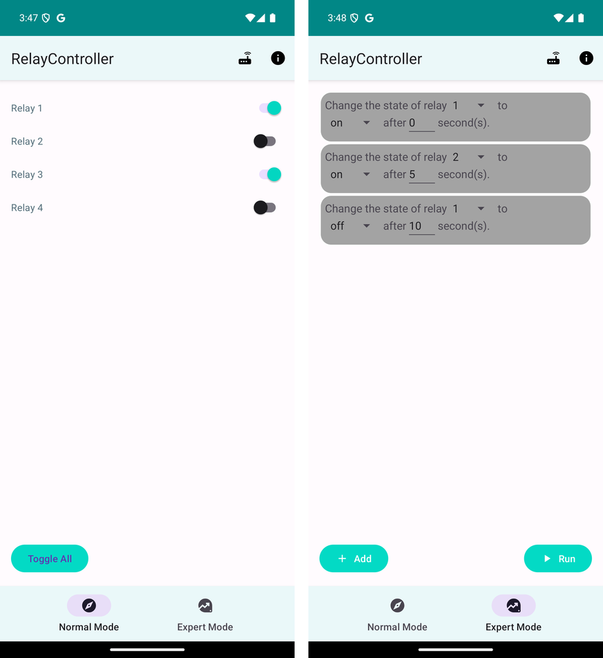

# RelayController

> Relay controller for my Raspberry Pi.

<p align="center">
  
</p>

Android app for switching the relays connected to a Raspberry Pi. Normal Mode gives a switch for each of the four relays plus a **Toggle All** button; Expert Mode offers finer control.

## Build and run

```sh
./gradlew assembleDebug
adb install -r app/build/outputs/apk/debug/RelayController.apk
```

Or open the project in Android Studio and run it on a device or emulator.
